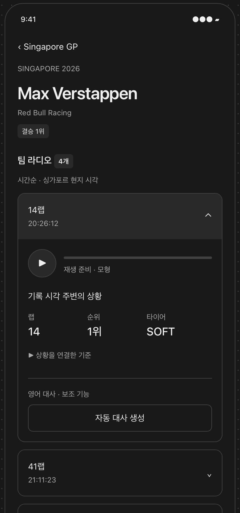

# 드라이버 라디오

[와이어프레임 바로 보기](https://gen-com.github.io/RadioLap/radio-lap.html) · [화면 흐름과 예시 안내](../../docs/WIREFRAMES.md)

와이어프레임은 교신을 선택하고 재생 영역과 상황 정보를 함께 살펴보는 경험을 설명합니다. 예시 데이터와 미리보기 제한, 화면에 포함된 모든 요소가 구현 범위를 뜻하지는 않습니다.
이미지의 결승 순위는 기본 정보에 포함하지 않으며, 대사 생성은 현재 합의한 범위에 포함하지 않습니다. 라디오 개수·시각·랩·순위·타이어 값과 현지 시각 표시는 예시입니다.

선택한 드라이버의 공개 라디오를 듣고, 기록 시각 주변의 랩·순위·타이어를 함께 살펴보며 교신이 나온 상황을 되짚습니다.

## 제공하려는 경험

### 누구의 어떤 레이스를 돌아보는지 알아봅니다

레이스 이름·시즌과 드라이버 이름·팀을 통해 상세에서 선택한 맥락을 이어갑니다. 최종 경기 결과보다 교신 무렵의 상황에 집중할 수 있게 합니다.

### 레이스의 흐름을 따라 교신을 고릅니다

공개 라디오를 기록 시각이 이른 순서로 살펴봅니다. 기록 시각과 연결 가능한 랩을 단서로 돌아보고 싶은 교신을 고를 수 있습니다. 랩 정보가 없어도 교신을 선택할 수 있으며, 공개 기록이 없다는 사실을 실제 교신이 없었다는 의미로 받아들이지 않도록 합니다.

### 원하는 교신을 듣고 상황을 함께 살펴봅니다

교신을 선택하면 재생 영역과 랩·순위·타이어 정보를 함께 확인합니다. 상황을 먼저 살펴본 뒤 원하는 때에 재생을 시작할 수 있습니다. 다른 교신을 고르면 기존 재생이 멈추어 새로 선택한 교신에 집중할 수 있습니다.

상황 정보는 교신을 이해하는 단서로 제공합니다. 드라이버의 의도나 교신의 원인을 단정하지 않습니다.

### 확인된 정보와 알 수 없는 상황을 구분합니다

상황 정보는 라디오 기록 시각을 기준으로 연결하며, 실제 발화 시각과 차이가 있을 수 있음을 알립니다.

연결할 수 없는 항목은 정보가 없다는 사실을 드러냅니다. 이전에 확인된 정보를 보여줄 때는 ‘마지막 확인 정보’로 구분하여, 교신 무렵의 확정된 상황으로 오해하지 않도록 합니다.
