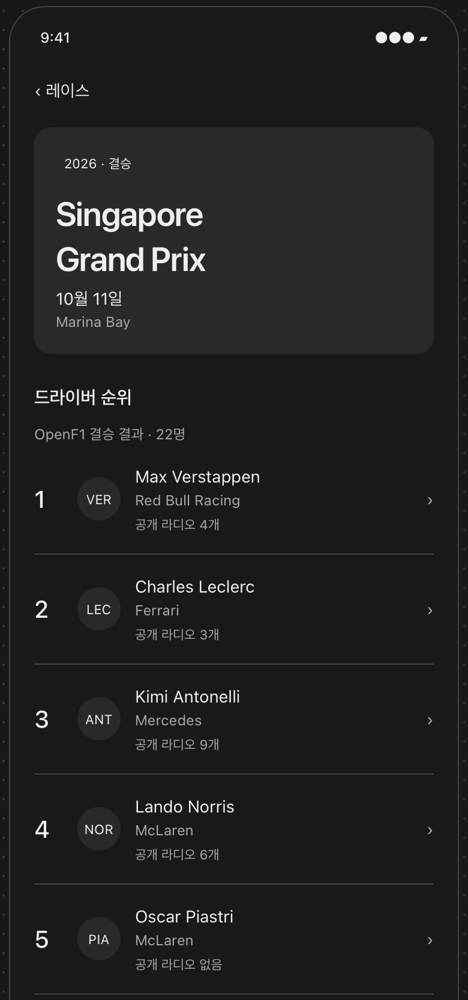

# 레이스 상세

[전체 와이어프레임 HTML](../../docs/radio-lap.html) · [화면 흐름과 예시 안내](../../docs/WIREFRAMES.md)

이미지의 레이스·드라이버·순위·인원수는 경험을 설명하기 위한 예시입니다. 공개 라디오 개수 표시는 현재 구현 범위에서 보류되어 있습니다.

선택한 레이스의 결과를 살펴보고, 교신을 통해 돌아보고 싶은 드라이버를 고를 수 있게 합니다.

## 제공하려는 경험

### 어떤 경기였는지 확인합니다

대회 이름과 개최 날짜·장소를 통해 선택한 레이스를 알아보고, 참가 드라이버의 결승 결과를 함께 살펴봅니다.

### 제공된 결과를 오해 없이 읽습니다

순위와 미완주 같은 경기 상태를 함께 살펴볼 수 있게 합니다. 순위나 결과가 제공되지 않은 경우에도 확인된 정보와 구분해, 알 수 없는 결과를 추측하지 않도록 합니다.

### 레이스에서 드라이버의 교신으로 이어갑니다

선택한 레이스의 결과를 살펴보며 돌아보고 싶은 드라이버를 고릅니다. 레이스를 고르는 데서 시작한 탐색이 해당 드라이버의 교신과 당시 상황을 되짚는 경험으로 이어집니다.
