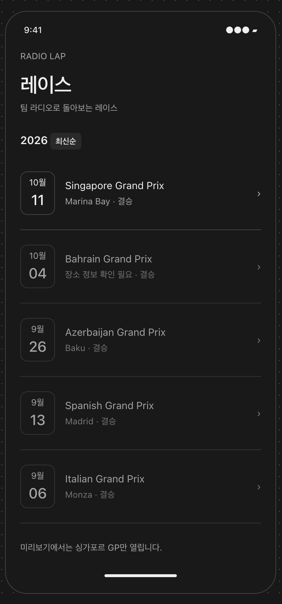

# 레이스 목록

[와이어프레임 바로 보기](https://gen-com.github.io/RadioLap/radio-lap.html) · [화면 흐름과 예시 안내](../../docs/WIREFRAMES.md)

최근 열린 레이스부터 살펴보고, 돌아보고 싶은 레이스를 선택할 수 있게 합니다.

## 제공하려는 경험

### 최근 열린 경기부터 돌아봅니다

이미 열린 경기를 돌아보는 데 집중할 수 있도록 종료된 결승을 최신순으로 보여줍니다. 사용자는 최근 레이스부터 살펴보며 돌아보고 싶은 경기를 선택할 수 있습니다.

### 어떤 레이스인지 알아보고 선택합니다

대회 이름과 개최 날짜·장소를 함께 보여줍니다. 사용자는 언제, 어디서 열린 경기인지도 단서로 삼아 원하는 레이스를 찾고 상세 화면으로 이동할 수 있습니다.

### 확인되지 않은 정보는 구분해 보여줍니다

개최 장소를 확인할 수 없는 경우에는 그 사실을 표시합니다. 사용자가 레이스를 선택할 때 확인된 정보와 아직 확인되지 않은 정보를 구분할 수 있도록 합니다.
