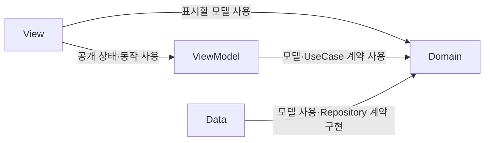
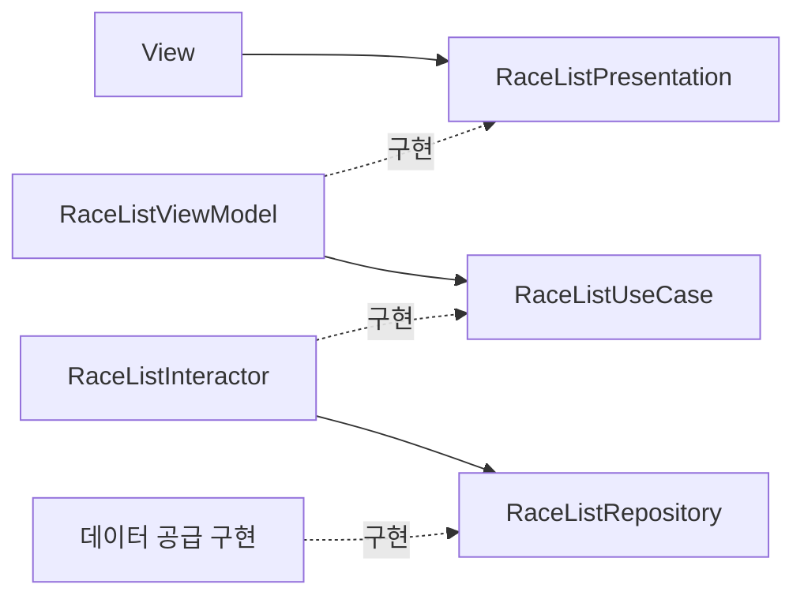
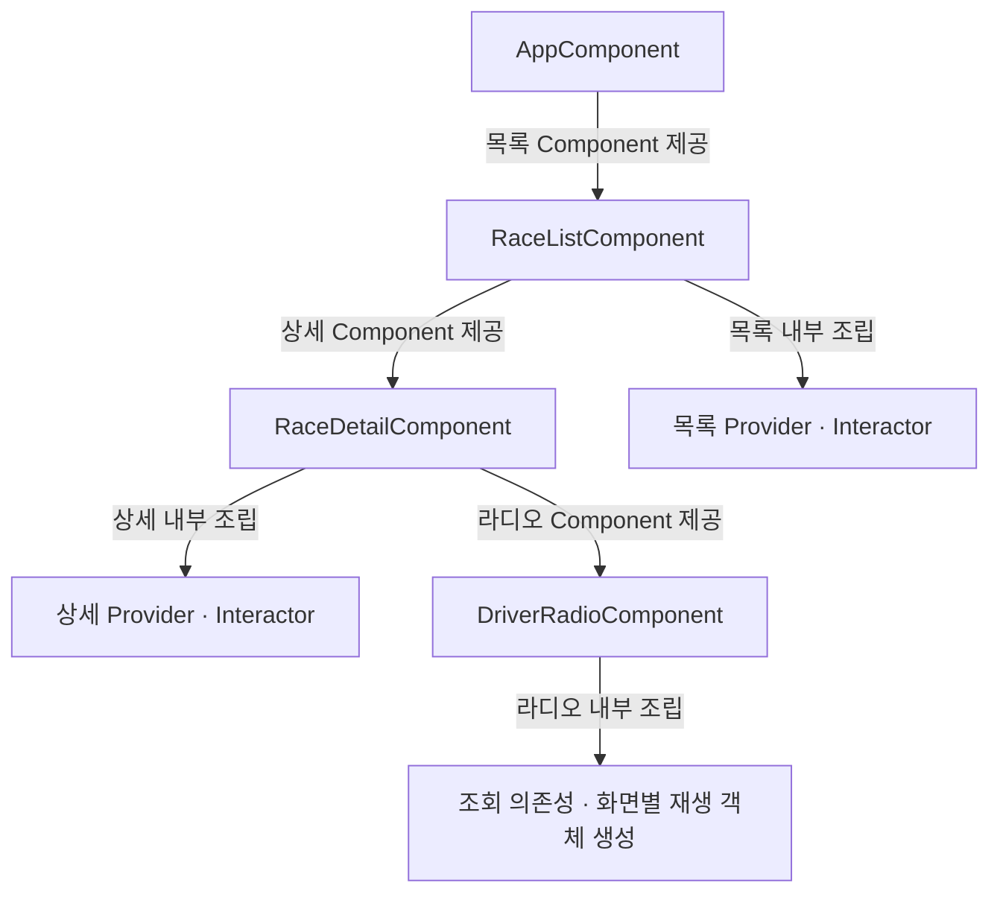
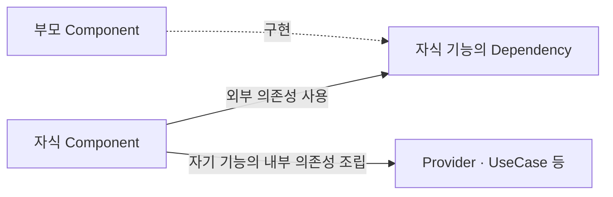

# RadioLap 아키텍처

## 목적과 적용 범위
RadioLap의 책임 분리·의존 방향·의존성 조립과 계층 추가에 적용하는 공통 규칙입니다. 기능별 세부 조건은 해당 계약을 따릅니다.

## 책임과 의존 방향

### 책임을 나누는 기준
책임은 변경되는 이유를 기준으로 나눕니다. 데이터 공급 방식, 화면 표현, 앱의 핵심 개념은 서로 다른 이유와 주기로 변경되므로 각 영역을 분리하고 경계에서 교체할 수 있게 합니다.

Domain은 앱이 다루는 핵심 개념과 규칙을 담으며, 데이터 공급 방식이나 화면에 비해 상대적으로 오래 유지됩니다.

Data와 Presentation이 Domain에 의존하게 하여, 공급 방식과 화면의 변경이 핵심 개념과 계약에 미치는 영향을 줄입니다.

| 영역 | 변경되는 이유 |
| --- | --- |
| Domain | 앱의 핵심 개념과 업무 규칙이 바뀜 |
| Data | 데이터 출처나 조회·응답 처리 방식이 바뀜 |
| Presentation | 표현할 상태나 화면의 표현·상호작용이 바뀜 |

계층이나 타입은 독립적인 책임이 있을 때 추가합니다. Repository 호출을 그대로 전달하기만 하는 Interactor처럼 구조를 맞추기 위한 코드는 작성하지 않습니다.

### 무엇을 표현할지와 어떻게 표현할지
Presentation에서는 무엇을 표현할지와 어떻게 표현할지를 나눕니다.

ViewModel은 조회 결과를 바탕으로 로딩·목록·빈 결과·실패 등 표현할 상태를 결정하고, 요청의 유효성을 관리합니다. 레이스 목록의 제공 대상과 최신순 정렬은 Domain의 UseCase가 보장하며, ViewModel은 반환 순서를 유지합니다. View는 그 상태를 받아 배치·날짜 형식·로딩 표시 등 화면으로 표현하는 방식을 담당합니다.

예를 들어 로딩 표시를 스피너에서 다른 형태로 바꾸더라도 ViewModel의 로딩 상태는 유지할 수 있습니다. 반면 재조회 중 기존 목록을 유지하도록 동작을 바꾼다면 표현할 상태가 달라지므로 ViewModel의 상태 계약을 검토합니다.

### 책임 구분

| 영역 | 책임 | 맡지 않는 책임 |
| --- | --- | --- |
| Domain | 모델의 의미, Repository·UseCase의 입출력·보장 조건, 화면과 독립적인 업무 규칙 정의와 수행 | 외부 응답 형식 해석, 화면 상태 |
| Data | 파일·API에서 자료 조회, 응답 해석·연결·형식 변환, 계약에 맞는 Domain 모델 반환 | 목록 제공을 위한 선별·정제·정렬, 화면 상태 |
| Presentation / ViewModel | 조회 요청·재시도·취소, 요청 결과의 유효성 판단과 화면 상태 관리 | 파일·API 직접 접근, 외부 응답 해석, 목록 도메인 규칙 재수행 |
| Presentation / View | 상태 표시, 날짜 표현, 사용자 이벤트 전달, 화면 생명주기에 따른 ViewModel 호출 | 외부 자료 조회·변환, 조회 결과의 유효성 판단 |
| Dependency / 의존성 계약 | 기능이 부모에게서 받아야 하는 외부 의존성 선언 | 기능 내부 구현의 조립, 화면 진입 입력과 화면 동작 |
| Dependency / Component | 자기 기능의 구체 구현 생성·의존성 조립과 다음 기능의 Component 제공 | 다른 기능의 내부 조립, 화면 상태 소유 |

Domain의 계약은 호출자에게 무엇을 보장할지 정의합니다. 레이스 목록의 Repository는 외부 자료를 해석·연결해 후보 도메인 모델을 제공하고, UseCase는 후보의 선별·정제·중복 처리·최신순 정렬을 수행합니다.

레이스 목록에서 `RaceListUseCase`와 그 구현인 `RaceListInteractor`는 Domain에 둡니다. Interactor는 Repository 계약에 의존하며 구체 Provider를 알지 못합니다. `RaceListPresentation`은 View가 사용하는 상태·동작 계약이고 `RaceListViewModel`이 구현합니다. 이는 레이스 목록의 책임 분리이며 다른 기능에 같은 계층을 기계적으로 추가하는 규칙은 아닙니다.

### 코드 의존 방향
화살표는 타입·계약을 참조하는 방향입니다. 실행 순서나 데이터 전달 방향을 뜻하지 않습니다.

Domain은 Data·Presentation·조립 타입을 참조하지 않고, Data는 Presentation을 참조하지 않습니다. 폴더를 나누는 것만으로 의존 방향이 강제되지는 않으므로 타입을 추가하거나 변경할 때 참조 관계도 확인합니다.

레이스 목록의 계약 참조와 구현 관계는 다음과 같습니다.

### 구현체 교체와 계약
데이터 공급 방식을 교체하더라도 소비자가 기대하는 동작의 의미는 유지해야 합니다. 테스트용 구현과 라이브 구현은 같은 Repository 계약을 따르며, 조회 조건·반환값·빈 결과·실패·취소·순서 보장의 의미를 일관되게 제공합니다.

프로토콜의 메서드 형태가 같아도 한 구현은 실패를 오류로 전달하고 다른 구현은 빈 결과로 바꾼다면 같은 동작으로 교체할 수 없습니다. 구현체를 추가하거나 교체할 때는 기능별 Repository 계약과 완료기준을 기준으로 확인합니다.

## 의존성 조립 규칙
의존성 조립은 사용하는 곳 밖으로 분리합니다. 개발자가 소비자의 동작을 읽을 때 구체적인 구현체의 생성 과정까지 함께 따라가지 않도록 하고, 조립 지점에서는 어떤 구현이 연결되는지 확인할 수 있도록 하기 위함입니다.

- 각 Component는 자기 기능의 구체 Provider를 선택·생성하고 내부 의존성을 조립합니다. 목록 Component는 목록 Repository를 Interactor에 주입하고, 상세 Component는 상세의 내부 의존성을 조립합니다.
- 앱 Component는 시작 기능의 Component를, 기능 Component는 다음 기능의 Component를 제공합니다. 화면은 호출부에서 직접 선언하고 해당 기능의 Component를 주입합니다. 다음 기능의 Provider·Interactor 조립은 해당 Component에 맡기며, 화면 생성만 전달하는 메서드는 두지 않습니다.
- Dependency는 기능이 부모에게서 받아야 하는 외부 의존성의 계약입니다. 자식 Component는 이 계약을 통해 의존성을 받고, 부모 Component는 필요한 경우 자식의 Dependency를 구현해 제공합니다. 자기 기능에서 조립할 UseCase를 부모에게 요구하기 위한 계약으로 사용하지 않습니다.
- 부모에게서 받을 외부 의존성이 없다면 Dependency를 두지 않습니다. Component의 계층을 맞추기 위한 빈 프로토콜은 만들지 않습니다.
- 선택한 Race처럼 탐색마다 달라지는 값은 화면 진입 입력으로 전달합니다. 부모가 제공하는 공통 의존성과 구분하며 Dependency에 넣지 않습니다.
- 목록 ViewModel은 UseCase 계약을 주입받으며 Repository를 직접 호출하거나 Interactor·Provider를 생성하지 않습니다. 다른 기능의 소비자 의존성은 해당 기능 계약을 따릅니다.
- 기능 진입 View는 조립된 UseCase 등 필요한 의존성으로 ViewModel을 생성하거나 준비된 ViewModel을 전달받아 SwiftUI 상태로 소유합니다. 화면 이동용 선택과 이동 상태는 View가 소유합니다. 재생 제어처럼 기능 동작과 함께 바뀌는 선택은 해당 상태를 담당하는 객체가 관리하며, 구체적인 책임은 기능별 계약에서 정합니다. 사용자 이벤트는 해당 동작을 담당하는 객체에 전달합니다. Component는 목적지에 필요한 Component를 제공합니다. 기능 진입 View는 주입받은 자기 Component에서 필요한 의존성을 꺼내며, ViewModel에는 Component 전체가 아닌 필요한 계약만 전달합니다.
- 보조 View에 전달할 데이터와 이벤트의 범위는 [코드 작성 규칙의 SwiftUI 화면 구성 기준](CODING_CONVENTIONS.md#swiftui-화면-구성)을 따릅니다.
- Component는 화면 상태를 소유하지 않습니다. Component와 내부 객체의 생성 시점·공유 범위·수명은 기능 요구에 따라 별도로 정하며, 조립 계층만으로 결정하지 않습니다.

다음은 합의한 **기능별 조립과 진입 연결 방향**입니다. 화살표는 기능 진입에 필요한 Component 제공과 내부 의존성 조립 책임을 나타내며, 객체 생성 시점이나 소유 수명을 뜻하지 않습니다.

자식 기능이 외부 의존성을 요구할 때의 계약 관계는 다음과 같습니다. Dependency는 자식 기능이 정의하며, 부모가 제공할 수 있는 모든 객체가 아니라 자식에게 필요한 것만 선언합니다.

목록과 상세는 각 Component에서 데모 Provider·Interactor를 조립합니다. 현재 부모에게서 받을 공통 의존성은 없어 별도 Dependency를 두지 않고, 기능 진입 View에 해당 Component를 주입합니다. 앱은 RaceListView를 직접 선언하고, 목록·상세 View는 navigationDestination 안에서 다음 화면을 직접 선언합니다. 정해진 목적지를 교체하기 위한 View 제네릭이나 생성 클로저는 두지 않으며 각 화면의 Presentation만 제네릭으로 유지합니다. 각 View는 자기 Component에서 받은 다음 기능의 Component를 보관해 목적지에 전달합니다. AppComponent는 목록 Component를, 목록 Component는 상세 Component를 보관하며 각 기능의 UseCase는 Component 생성 시 조립합니다. ViewModel과 화면 상태는 각 View가 소유합니다. 상세 Component는 라디오 Component를 제공하고 상세 View는 Race·RaceDriver와 함께 DriverRadioView에 주입합니다. 라디오 Component는 조회 의존성을 조립하고 요청마다 새 재생 객체를 제공합니다. 라디오 View는 최초 진입 작업에서 ViewModel과 전용 재생 객체를 한 번 생성해 화면 수명 동안 보존하며 View 값의 재생성으로 오디오를 다시 만들지 않습니다. 이 조립 구조와 실제 동작의 검증 결과는 구분합니다.

Repository 테스트는 자료의 요청·해석·후보 변환을 확인합니다. UseCase 테스트는 Repository 테스트 대역을 통해 선별·정제·정렬 규칙을 확인하고, ViewModel 테스트는 UseCase 테스트 대역으로 화면 상태와 요청 유효성을 확인합니다.

## 관련 문서
공통 아키텍처 규칙은 이 문서에 유지합니다. 기능별 문맥·계약·완료기준은 각 기능의 문서에서, 작업 범위와 승인 절차는 AGENTS.md에서 확인합니다.

- [목록 작업 안내](../RadioLap/RaceList/AGENTS.md): 목록 작업 범위·Repository·UseCase 계약·화면 상태·완료기준의 진입점
- [상세 작업 안내](../RadioLap/RaceDetail/AGENTS.md): 상세 목적·Repository·UseCase·화면 계약·완료기준의 진입점
- [코드 작성 규칙](CODING_CONVENTIONS.md): 메서드 명명과 SwiftUI 화면 구성
- [문서화 규칙](DOCUMENTATION.md): Swift 파일 헤더와 Domain 모델·Repository 계약의 문서 주석
- [테스트 작성 원칙](TESTING.md): 계약 기반 검증과 테스트 구성
